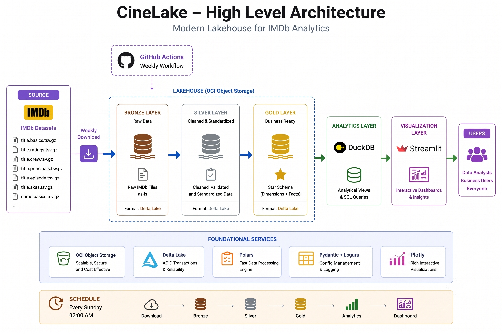

<div align="center">

# 🎞️ CineLake

**A local IMDb lakehouse experiment with explicit implementation stages.**


[Status](#implementation-status) · [Quick start](#quick-start) · [Design docs](#design-documentation)

</div>

---

CineLake explores IMDb ingestion and a Bronze/Silver/Gold architecture using Polars and Delta Lake. The current implementation downloads to local disk, writes Bronze Delta tables, and validates/transforms Bronze data in memory for the Silver stage.

<a id="implementation-status"></a>

## 🚧 Implementation status

| Stage | Current behavior |
|---|---|
| Download | Fetches seven configured IMDb TSV archives into `data/raw/`; skips existing files |
| Bronze | Reads TSV, normalizes missing values, adds ingestion metadata, and overwrites local Delta tables |
| Silver | Checks schemas and keys, converts types, and cleans strings; **does not yet write Silver tables** |
| Gold | CLI command exists, but the processor call is commented out |
| Analytics/dashboard | Empty scaffolding |
| Automation | `.github/workflows/imdb_refresh.yml` is empty; no scheduled refresh is implemented |
| OCI storage | Appears in design plans; the current runtime uses local `Path`-based storage |

<a id="quick-start"></a>

## 🚀 Quick start

Requires Python **3.11+**, [uv](https://docs.astral.sh/uv/), internet, and enough local storage/memory for IMDb's large datasets.

```bash
git clone https://github.com/Vignesh-S-GitHub/cinelake-imdb-analytics.git
cd cinelake-imdb-analytics
uv sync --locked
uv run python -m cinelake.cli --help
uv run python -m cinelake.cli download
uv run python -m cinelake.cli bronze
uv run python -m cinelake.cli silver
```

Run from the root: [config/settings.toml](config/settings.toml) and data paths are relative to it. `silver` currently reports validation results; it is not a materialized Silver dataset. `gold` produces no analytical output yet.

## 🧱 Design direction



The diagram describes the intended architecture. Use the status table above to distinguish it from the code currently implemented.

## ⚙️ Configuration and data behavior

- [settings.toml](config/settings.toml) selects source files, download timeout/retries, and local layer prefixes.
- Bronze writes use overwrite mode. Retain a separate copy if an earlier dataset version matters.
- The downloader skips an existing destination; inspect/remove an incomplete file before retrying after a failed download.
- Bronze catches per-dataset exceptions and continues. Check the logs for every dataset; the final completion message alone does not prove that all tables succeeded.
- No OCI credentials or cloud resources are needed for the implemented local workflow.

<a id="design-documentation"></a>

## 📖 Design documentation

[Architecture](docs/ARCHITECTURE.md) · [Business requirements](docs/BUSINESS_REQUIREMENTS.md) · [Data model](docs/DATA_MODEL.md) · [Source analysis](docs/SOURCE_SYSTEM_ANALYSIS.md) · [Development plan](docs/DEVELOPMENT_PLAN.md).

These documents include future plans. [IMDb dataset terms](https://developer.imdb.com/non-commercial-datasets/) apply to source data independently of the project code. No non-empty automated test suite is currently included.

## 🤝 Contributing

Open an issue with a reproducible example or submit a focused pull request. Keep setup instructions and documentation aligned with any behavior changes.

## 📄 License

No repository-level `LICENSE` file is currently included.
